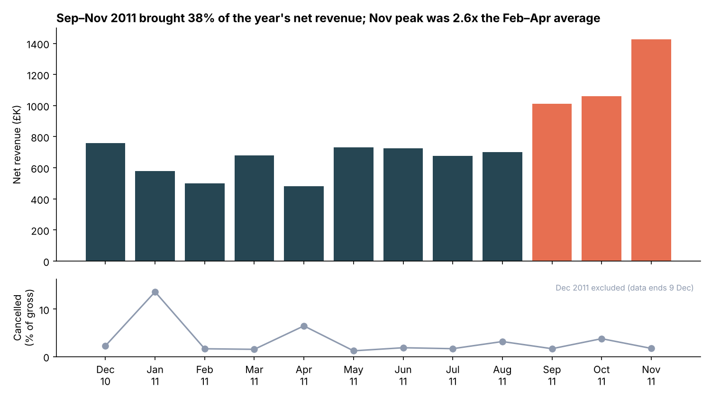
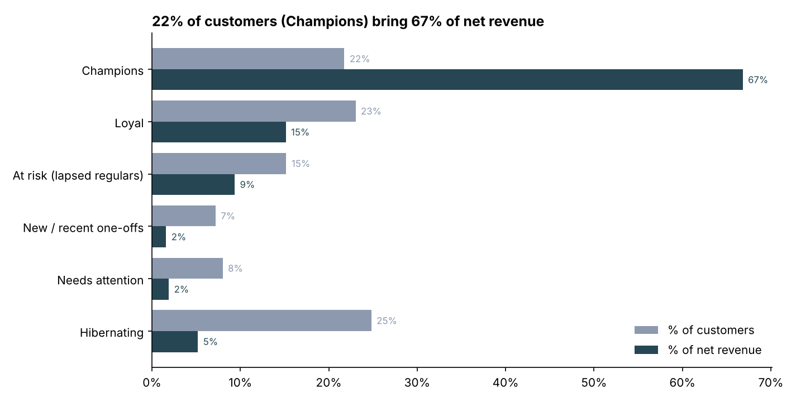
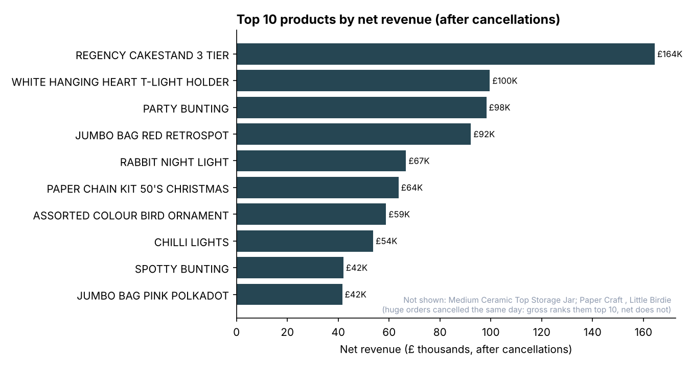
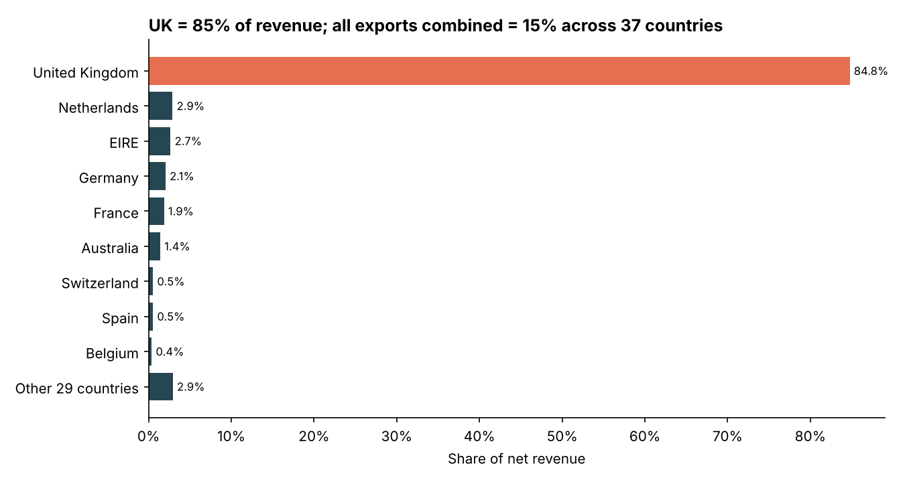
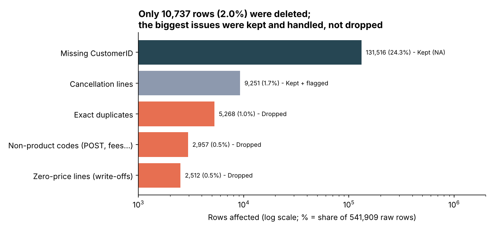

# Online Retail: Data Cleaning, EDA & RFM Segmentation

**Business question:** a UK online gift wholesaler wants to know where its revenue
really comes from, which customers to protect or win back, and when to plan for peak
demand. The raw transaction log is messy, so answering correctly starts with
**documented cleaning decisions**.

All money is in **GBP (£)**. All revenue figures are **net of cancellations**.

## Recommendations

| # | Action | Evidence |
|---|---|---|
| 1 | **Protect the top accounts.** Give the 941 "Champions" dedicated account management. | 22% of customers bring **67%** of net revenue (£5.53M). |
| 2 | **Run a win-back campaign** for 657 lapsed regulars. | They placed 3+ orders but haven't ordered in a median of **131 days**. Winning back 1 in 10 at their median spend (£710) ≈ **£47K**, a conservative floor. |
| 3 | **Plan stock and cash for Sep–Nov.** | Sep–Nov brought **38%** of the year's net revenue; November was **2.6×** the Feb–Apr average. |
| 4 | **Add an order-quantity check** at entry. | Two single orders (74,215 and 80,995 units, £246K) were keyed in and cancelled within 20 minutes. They also distort any gross-revenue ranking. |
| 5 | **Capture customer IDs on every order.** | 25% of lines (**15% of sales**) have no customer ID, so that revenue can't be used for CRM or segmentation. |

## Key numbers (cleaned data, 1 Dec 2010 – 9 Dec 2011)

- Net revenue **£9.77M** = £10.25M gross sales − £0.48M cancellations (4.6%)
- **19,773** sales invoices (plus 3,422 cancellation invoices), average order **£518**
- 3,914 products, 4,362 identified customers, 38 countries
- UK = **85%** of net revenue; Netherlands, EIRE, Germany and France are 1.9–2.9% each
- Top product: *Regency Cakestand 3 Tier* (£164K net)

## Charts

**Seasonality.** Q4 is the business: plan inventory from August.


**Customer concentration (RFM).** A fifth of customers bring two-thirds of revenue.


**Top products by net revenue.** Two items that a gross ranking would place in the top 10 were huge orders cancelled the same day.


**Market concentration.** All 37 export markets together are 15% of revenue.


**What cleaning did.** Only 2% of rows were deleted; the larger problems were kept and handled.


## Data audit: what was wrong and what we did

| Problem | Rows | Decision |
|---|---|---|
| Exact duplicate lines | 5,268 | Dropped |
| Cancellation lines (invoice starts with "C") | 9,251 | **Kept**, flagged. They are real lost revenue and are netted out of every figure |
| Negative quantity on a normal invoice | 1,336 | All are zero-price stock write-offs, removed with the next rule |
| Zero/negative unit price | 2,512 | Dropped. These are write-offs and adjustments (98% have no customer), not sales |
| Non-product codes (POST, DOT, M, C2, bank/Amazon fees …) | 2,957 | Dropped. These are postage, manual adjustments and fees, not products |
| Missing Description | 1,454 raw | All were zero-price lines, so none remain |
| **Missing CustomerID** | **131,516** (24.8% of lines, 14.7% of sales) | **Kept as NA**. Revenue analyses use all rows; RFM uses identified customers only |

Every step, with counts and reasons, is logged in `cleaning_report.json`.

## RFM method

- **Monetary = net spend** (sales minus that customer's cancellations). Using gross spend would credit customers for orders they cancelled: one customer would rank as "Loyal" on £168K of orders that netted £2.90.
- 10 customers whose net spend is ≤ £0 are excluded from scoring; 4,324 are scored.
- R, F and M are scored 1–5 by quintile (ties broken by rank). Snapshot date: 2011-12-10.
- Segment rules (exhaustive, non-overlapping): Champions (R≥4, F≥4, M≥4) · Loyal (R≥3, F≥3) · At risk (R≤2, F≥3) · New/recent one-offs (R≥4, F≤2) · Needs attention (R=3, F≤2) · Hibernating (R≤2, F≤2).

| Segment | Customers | Net revenue | Revenue share | Median days since last order |
|---|---|---|---|---|
| Champions | 941 (22%) | £5.53M | **66.8%** | 10 |
| Loyal | 996 (23%) | £1.25M | 15.1% | 33 |
| At risk (lapsed regulars) | 657 (15%) | £0.77M | 9.4% | 131 |
| Hibernating | 1,073 (25%) | £0.43M | 5.2% | 218 |
| Needs attention | 346 (8%) | £0.16M | 1.9% | 52 |
| New / recent one-offs | 311 (7%) | £0.13M | 1.6% | 18 |

## Limitations

- **Revenue, not profit.** The data has no cost or margin data, so "top" means top by revenue.
- **One year of data.** The Sep–Nov peak is a single season, not a proven pattern.
- December 2011 stops on the 9th and is excluded from the monthly trend.
- RFM quintiles are relative to this customer base, and the win-back figure is a scenario, not a forecast.

## Data source and verification

UCI Machine Learning Repository, *Online Retail* (Chen, 2015), doi:[10.24432/C5BW33](https://doi.org/10.24432/C5BW33).
It covers all transactions from 01/12/2010 to 09/12/2011 for a UK-based online retailer, and UCI notes that many of its customers are wholesalers.

Verification: the data used has **541,909 rows** and runs from 1 Dec 2010 to 9 Dec 2011, matching UCI's metadata. It has 406,829 non-null CustomerIDs and 540,455 non-null Descriptions, matching the standard `df.info()` of the UCI `.xlsx`.
Note that UCI's page lists "Has Missing Values: No", which is wrong: 135,080 raw rows have no CustomerID.

## Reproduce

```bash
pip install -r requirements.txt
mkdir -p data
# Option A: UCI original -> data/"Online Retail.xlsx"
#   https://archive.ics.uci.edu/dataset/352/online+retail
# Option B: identical 541,909 rows as CSV -> data/online-retail.csv
curl -L -o data/online-retail.csv \
  https://raw.githubusercontent.com/databricks/Spark-The-Definitive-Guide/master/data/retail-data/all/online-retail-dataset.csv
python clean.py && python analyze.py && python rfm.py
```

## Files

| File | What it is |
|---|---|
| `clean.py` | Audit → documented cleaning steps → `data/retail_clean.csv` + `cleaning_report.json` |
| `analyze.py` | Charts 1–4 + `eda_kpi.json`, `monthly.csv`, `top_products.csv`, `by_country.csv` |
| `rfm.py` | RFM scores and segments → chart 5, `rfm_segments.csv`, `rfm_customers.csv`, `rfm_kpi.json` |
